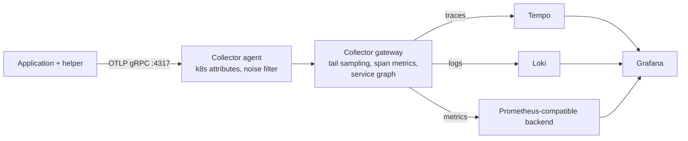

# Observability overview

This page shows how the telemetry the helpers emit reaches the backends, and
how Grafana is wired so you can move from a metric to a trace to a log. The
pages in this section are about **using** that telemetry: what each signal is
good for, how the signals link, and how to diagnose a service with them.

**Audience:** application engineers on call, and platform engineers who run
the Collector and Grafana.

## The pipeline



| Who | Sets |
|-----|------|
| The helper (SDK) | `service.name`, `deployment.environment.name`, `service.instance.id`, the span and log `trace_id` / `span_id`, exemplars |
| Collector agent | `k8s.*` resource attributes (`k8sattributes`) |
| Collector gateway | The tail-sampling decision; **span metrics** (`traces_span_metrics_*`) and the **service graph** (`traces_service_graph_*`), computed from every span before tail sampling |

Span metrics and the service graph count every span before tail sampling,
kept or not. Spans the SDK drops are not counted, but there are none with
the default `parentbased_always_on`. So they are the reliable source for request rates and error ratios. Tempo keeps only
the sampled traces. The platform requirements are in
[Collector prerequisites](../platform/collector.md).

## The demo used in these pages

The screenshots and queries come from the four-language demo on the k8s01
test cluster, namespace `dev-otel-libs`. For each language:

- `demo-<lang>-worker` posts orders to `demo-<lang>-api`;
- the api calls `demo-<lang>-backend` over gRPC (`demo.v1.OrderService/PlaceOrder`);
- the backend writes to PostgreSQL.

About one order in ten fails on purpose:

- a duplicate (`409`, PostgreSQL `23505`);
- a rejection (`422`);
- an unhandled error (`500`).

Contract: [demo README](https://github.com/StaffOps/otel-libs/blob/main/demo/README.md).

## Grafana wiring

Grafana has four data sources, linked to each other. This is an excerpt of
the provisioning used on the demo, with the fields that matter for
correlation (adapt the UIDs and label names):

```yaml
apiVersion: 1
datasources:
  - name: Prometheus
    type: prometheus
    uid: prometheus
    jsonData:
      # metric -> trace: an exemplar's trace_id opens the trace in Tempo
      exemplarTraceIdDestinations:
        - { name: trace_id, datasourceUid: tempo, urlDisplayLabel: View trace }
  - name: Loki
    type: loki
    uid: loki
    jsonData:
      # log -> trace: trace_id is structured metadata, so match it as a label
      derivedFields:
        - name: trace_id
          matcherType: label
          matcherRegex: "^trace_id$"
          datasourceUid: tempo
          url: "$${__value.raw}"
  - name: Tempo
    type: tempo
    uid: tempo
    jsonData:
      serviceMap: { datasourceUid: prometheus }   # Service Graph tab
      nodeGraph: { enabled: true }
      lokiSearch: { datasourceUid: loki }
      # trace -> logs: "Logs for this span"
      tracesToLogsV2:
        datasourceUid: loki
        spanStartTimeShift: "-5m"
        spanEndTimeShift: "5m"
        customQuery: true
        query: '{service_name="$${__span.tags["service.name"]}"} | trace_id="$${__trace.traceId}" | span_id="$${__span.spanId}"'
      # trace -> metrics: rate, errors and latency of the span
      tracesToMetrics:
        datasourceUid: prometheus
        tags: [{ key: service.name, value: service_name }]
        queries:
          - name: Span calls by status
            query: 'sum by (status_code, error_type) (rate(traces_span_metrics_calls_total{$$__tags, span_name="$${__span.name}"}[5m]))'
          - name: Span p95
            query: 'histogram_quantile(0.95, sum by (le) (rate(traces_span_metrics_duration_seconds_bucket{$$__tags, span_name="$${__span.name}"}[5m])))'
```

`$$` escapes the environment-variable expansion of provisioning files; type a
single `$` in the UI.

OTLP-ingested logs keep `trace_id` and `span_id` as Loki **structured
metadata**, not in the log line. A line filter finds nothing, so the queries
above filter the metadata (`| trace_id="…"`).

!!! note "Screenshot (phase 2)"
    Grafana Explore → Tempo → **Service Graph** tab, filter
    `service.name =~ "demo-.*"`: the worker → api → backend → PostgreSQL edges
    of the four languages.

## Where to go next

| I want to… | Page |
|------------|------|
| Find a slow or failed request | [Traces](signals/traces.md) |
| Chart rates, errors, latency and saturation | [Metrics](signals/metrics.md) |
| Read the error message and stack | [Logs](signals/logs.md) |
| Jump between the three | [Correlation](correlation.md) |
| Work through an incident | [Diagnosis: RED](diagnosis/red.md), [Errors](diagnosis/errors.md) |
| Open a ready-made view | [Dashboards](../dashboards/overview.md) |
